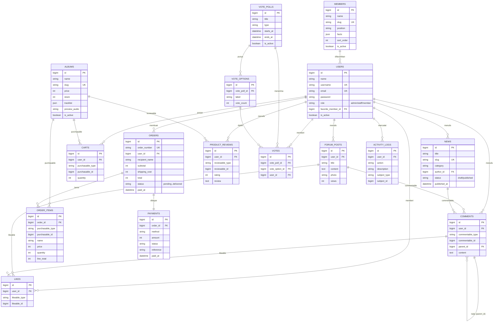

# 📄 Product Requirement Document (PRD)
## MONSTER HUB — Platform Komunitas & Toko Album BABYMONSTER

| | |
|---|---|
| **Nama Aplikasi** | MONSTER HUB |
| **Tagline** | Rumahnya MONBEBE Indonesia 👾💜 |
| **Mata Kuliah** | Pemrograman Web 2 — Ujian Akhir Semester |
| **Stack Utama** | Laravel 12 · Blade · Tailwind CSS v4 · Alpine.js · SQLite |
| **Versi Dokumen** | 1.0 |

---

## 1. Project Overview

### 1.1 Latar Belakang Masalah
Penggemar (fandom **MONBEBE**) grup K-pop **BABYMONSTER** di Indonesia tersebar di banyak platform berbeda: beli album di marketplace, diskusi di media sosial, voting di aplikasi pihak ketiga, dan mengikuti berita dari akun fanbase. Tidak ada **satu tempat terpusat** yang ramah dan menyenangkan untuk melakukan semuanya sekaligus.

**MONSTER HUB** hadir sebagai solusi: sebuah platform web tunggal yang menggabungkan **toko album resmi**, **komunitas forum**, **voting member**, **berita terbaru**, dan **pemutar preview album** dalam satu pengalaman bertema ceria khas BABYMONSTER.

### 1.2 Tujuan Aplikasi
- Menyediakan katalog & simulasi pembelian album (CRUD + keranjang + checkout).
- Membangun keterlibatan komunitas lewat forum diskusi, komentar, dan like.
- Memberi wadah interaksi fandom melalui voting member (1 akun = 1 suara).
- Menyajikan berita/update BABYMONSTER yang terkurasi.
- Menyediakan dashboard admin untuk mengelola seluruh konten.

### 1.3 Target Pengguna
| Segmen | Deskripsi |
|---|---|
| **Fans / Member** | Penggemar BABYMONSTER yang ingin beli album, ikut voting, berdiskusi, dan baca berita. |
| **Staff Konten** | Tim yang mengelola konten (album, berita, member, voting) dan memproses pesanan. |
| **Admin** | Pengelola tertinggi: semua kewenangan staff + manajemen akun & peran pengguna. |

---

## 2. User Personas & User Flow

### 2.1 User Personas (Aktor)

**A. Guest (Belum Login)**
- Melihat beranda, katalog album, profil member, berita, forum (baca), dan hasil voting.
- Tidak bisa membeli, berkomentar, atau voting → diarahkan untuk mendaftar/login.

**B. Member (Fan Terdaftar)**
- Semua akses guest **+**: kelola profil, tambah ke keranjang, checkout & bayar (simulasi), lihat riwayat pesanan & invoice, tulis ulasan album, buat & komentar post forum, like, dan voting.

**C. Staff**
- Semua akses member **+**: akses **Dashboard Admin** untuk CRUD album/berita/member/voting, memproses status pesanan, melihat log aktivitas, dan ekspor data pesanan.

**D. Admin**
- Semua akses staff **+**: **manajemen pengguna** (ubah peran, aktif/nonaktifkan akun).

### 2.2 User Flow Utama

**Flow 1 — Beli Album (Member):**
```
Beranda → Toko Album → Detail Album (putar preview) → Tambah ke Keranjang
→ Keranjang → Checkout (isi alamat + kurir) → Halaman Pembayaran (pilih metode, SIMULASI)
→ Konfirmasi Bayar → Pesanan "Dibayar" → Lihat Detail / Cetak Invoice
```

**Flow 2 — Voting Member (Member):**
```
Menu Voting → Pilih Polling Aktif → Pilih Member Favorit → Kirim Suara
→ Hasil real-time (bar chart) → (tidak bisa vote 2x pada polling sama)
```

**Flow 3 — Diskusi Forum (Member):**
```
Forum → Buat Post (judul + isi + foto opsional) → Post tampil
→ Fans lain memberi Like & Komentar (bisa balas berjenjang)
```

**Flow 4 — Kelola Konten (Staff/Admin):**
```
Login → Dashboard Admin → pilih modul (Album/Berita/Member/Voting)
→ Tambah/Edit/Hapus → aktivitas tercatat di Log Aktivitas
```

**Flow 5 — Proses Pesanan (Staff/Admin):**
```
Dashboard → Pesanan → Detail → Ubah Status (paid→process→shipped→delivered)
→ (opsional isi no. resi) → Ekspor daftar pesanan ke CSV
```

---

## 3. Functional Requirements

### 3.1 Autentikasi & Pengguna
| ID | Nama Fitur | Deskripsi Perilaku | Status |
|----|-----------|---------------------|--------|
| F-01 | Registrasi | Pengguna daftar dengan nama, username unik, email, password (default peran *member*). | Wajib |
| F-02 | Login / Logout | Autentikasi berbasis sesi; akun nonaktif ditolak masuk. | Wajib |
| F-03 | Verifikasi Email | Pengiriman tautan verifikasi email setelah registrasi. | Opsional |
| F-04 | Reset Password | Lupa password via tautan email. | Opsional |
| F-05 | Kelola Profil | Ubah nama, username, email, bio, avatar, & member favorit. | Wajib |
| F-06 | Ganti Password | Perlu verifikasi password lama. | Wajib |

### 3.2 Toko Album (E-Commerce)
| ID | Nama Fitur | Deskripsi Perilaku | Status |
|----|-----------|---------------------|--------|
| F-07 | Katalog Album | Daftar album dengan filter nama & rentang harga + paginasi. | Wajib |
| F-08 | Detail Album | Info lengkap, harga, stok, tracklist, rating, & ulasan. | Wajib |
| F-09 | Pemutar Album | Putar preview/simulasi track dengan kontrol play/pause & progress. | Wajib |
| F-10 | Keranjang | Tambah, ubah kuantitas, hapus item (per pengguna, tersimpan di DB). | Wajib |
| F-11 | Checkout | Isi data pengiriman + kurir; ongkir dihitung **di server**. | Wajib |
| F-12 | Pembayaran (Simulasi) | Pilih metode (Transfer/E-Wallet/QRIS); tandai lunas tanpa gateway nyata. | Wajib |
| F-13 | Riwayat Pesanan | Daftar & detail pesanan milik pengguna + timeline status. | Wajib |
| F-14 | Invoice | Halaman invoice siap-cetak (print/simpan PDF via browser). | Wajib |
| F-15 | Ulasan Album | Beri rating 1–5 + ulasan (1 ulasan per pengguna per album). | Wajib |

### 3.3 Komunitas & Konten
| ID | Nama Fitur | Deskripsi Perilaku | Status |
|----|-----------|---------------------|--------|
| F-16 | Forum | Buat, lihat, & hapus post (judul, isi, foto opsional). | Wajib |
| F-17 | Komentar | Komentar berjenjang (reply) pada post forum & berita. | Wajib |
| F-18 | Like | Toggle like pada post forum & komentar (polimorfik). | Wajib |
| F-19 | Voting | Polling member; 1 akun 1 suara per polling; hasil real-time. | Wajib |
| F-20 | Berita | Daftar & detail berita dengan kategori, filter, & pencarian. | Wajib |
| F-21 | Profil Member | Katalog & profil detail member BABYMONSTER (bio, fakta, fans). | Wajib |
| F-22 | Pencarian Global | Cari album, berita, member, & post forum sekaligus. | Wajib |

### 3.4 Dashboard Admin
| ID | Nama Fitur | Deskripsi Perilaku | Status |
|----|-----------|---------------------|--------|
| F-23 | Dashboard & Statistik | Ringkasan penjualan, grafik 12 bulan, produk terlaris. | Wajib |
| F-24 | CRUD Album | Kelola album + upload cover & audio preview + tracklist. | Wajib |
| F-25 | CRUD Berita | Tulis/ubah/hapus berita (draft/published) + thumbnail. | Wajib |
| F-26 | CRUD Member | Kelola data member + foto + fun facts. | Wajib |
| F-27 | Kelola Voting | Buat & hapus polling beserta opsinya. | Wajib |
| F-28 | Manajemen Pesanan | Lihat semua pesanan, ubah status, isi resi. | Wajib |
| F-29 | Ekspor Pesanan | Unduh daftar pesanan sebagai CSV. | Opsional |
| F-30 | Log Aktivitas | Catatan otomatis semua aksi admin/staff. | Opsional |
| F-31 | Manajemen Pengguna | (Admin) Ubah peran & aktif/nonaktifkan akun. | Wajib |

---

## 4. Non-Functional Requirements

### 4.1 Teknologi (Tech Stack)
| Lapisan | Teknologi |
|---|---|
| **Framework** | Laravel 12 (PHP 8.2+) |
| **Templating** | Blade Components (anonymous components) |
| **Styling** | Tailwind CSS v4 (via Vite) — tema custom "BabyMonster" |
| **Interaktivitas** | Alpine.js (pemutar album, tab, dropdown, form dinamis) |
| **Build Tool** | Vite 7 |
| **Database** | SQLite (portabel; mudah dideploy) |
| **Autentikasi** | Laravel (session-based, Breeze-style) |

### 4.2 Keamanan
- **Hashing Password:** algoritma **bcrypt** (cast `hashed` pada model User).
- **Proteksi Mass-Assignment:** kolom sensitif `role` & `is_active` **tidak** `fillable` — hanya diubah lewat aksi admin khusus (mencegah *privilege escalation*).
- **Otorisasi Berbasis Peran:** middleware `role:admin,staff` dan `role:admin` pada rute admin; middleware `auth` & `guest` untuk area sesuai.
- **Proteksi Kepemilikan (IDOR):** setiap akses keranjang, pesanan, & pembayaran memverifikasi `user_id` pemilik (abort 403 bila bukan miliknya).
- **CSRF Protection:** token CSRF otomatis pada semua form POST/PATCH/DELETE.
- **Validasi Input:** seluruh input divalidasi di server (rules Laravel) sebelum diproses.
- **Integritas Harga:** subtotal & **ongkos kirim dihitung ulang di server**, tidak pernah dipercaya dari klien.
- **Escaping Output:** Blade meng-escape output secara default (`{{ }}`) untuk mencegah XSS.
- **Morph Map:** relasi polimorfik memakai alias pendek (`album`, `forum_post`, dll.) agar database tidak terkopel dengan namespace PHP.

### 4.3 Kualitas Lain
- **Responsif:** mobile-first, teruji di 375px–1280px.
- **Portabilitas:** query dashboard di-*group* di sisi aplikasi agar kompatibel SQLite & MySQL.
- **Konsistensi UI:** satu design system (komponen Blade + token warna) dipakai seluruh halaman.

---

## 5. Database Schema

### 5.1 Ringkasan Tabel (17 tabel inti)

**Identitas & Fandom**
- **users** — `id, name, username(unik), email(unik), password, role[admin|staff|member], avatar, bio, favorite_member_id, is_active, email_verified_at, timestamps`
- **members** — `id, name, slug, birth_date, position, description, photo, facts(json), nationality, sort_order, is_active, timestamps`

**E-Commerce**
- **albums** — `id, name, slug, cover, price, stock, description, tracklist(json), release_date, preview_audio, is_active, timestamps`
- **carts** — `id, user_id(FK), purchasable_type, purchasable_id, quantity, size, color, timestamps` *(polimorfik)*
- **orders** — `id, order_number(unik), user_id(FK), recipient_name, address, phone, courier, payment_method, subtotal, shipping_cost, total, status[pending|paid|process|shipped|delivered|cancelled], tracking_number, paid_at, shipped_at, delivered_at, timestamps`
- **order_items** — `id, order_id(FK), purchasable_type, purchasable_id, name, price, quantity, size, color, line_total, timestamps` *(snapshot harga saat beli)*
- **payments** — `id, order_id(FK), method, amount, status, reference, paid_at, timestamps`
- **product_reviews** — `id, user_id(FK), reviewable_type, reviewable_id, rating(1–5), review, timestamps` *(polimorfik)*

**Komunitas**
- **forum_posts** — `id, user_id(FK), title, content, photo, share_count, views, timestamps`
- **comments** — `id, user_id(FK), commentable_type, commentable_id, content, parent_id, timestamps` *(polimorfik + reply berjenjang)*
- **likes** — `id, user_id(FK), likeable_type, likeable_id, timestamps` *(polimorfik; unik per user+target)*

**Voting**
- **vote_polls** — `id, title, type, starts_at, ends_at, is_active, timestamps`
- **vote_options** — `id, vote_poll_id(FK), label, image, vote_count, timestamps`
- **votes** — `id, vote_poll_id(FK), vote_option_id(FK), user_id(FK), timestamps` *(unik: 1 user 1 suara per poll)*

**Konten & Audit**
- **news** — `id, title, slug, thumbnail, content, excerpt, category, author_id(FK), published_at, views, status[draft|published], timestamps`
- **activity_logs** — `id, user_id(FK), action, description, subject_type, subject_id, timestamps`

### 5.2 Entity Relationship Diagram (ERD)

> Diagram di bawah ditulis dengan **Mermaid**. Ter-render otomatis sebagai diagram di GitHub / GitLab / VS Code (ekstensi Mermaid) / Typora. Untuk PDF, salin kode ke **https://mermaid.live** lalu ekspor sebagai PNG/SVG.



> **Catatan relasi polimorfik:** `carts` & `order_items` (purchasable), `product_reviews` (reviewable), `comments` (commentable), dan `likes` (likeable) memakai pasangan kolom `*_type` + `*_id`. Kolom `*_type` menyimpan alias morph pendek (mis. `album`, `forum_post`, `news`, `comment`), bukan nama kelas PHP penuh.

### 5.3 Akun Demo (hasil seeder)
| Peran | Email | Password |
|---|---|---|
| Admin | `admin@monsterhub.test` | `password` |
| Staff | `staff@monsterhub.test` | `password` |
| Member | `fan@monsterhub.test` | `password` |

---

## 6. Catatan Implementasi
- **Pembayaran bersifat SIMULASI** sesuai lingkup UAS — tidak ada integrasi payment gateway nyata; status pesanan ditandai lunas setelah konfirmasi.
- Data awal (album, member, berita, voting, pesanan demo, ulasan, komentar) tersedia otomatis via `php artisan migrate:fresh --seed`.
- Panduan menjalankan aplikasi ada di **README.md**.
