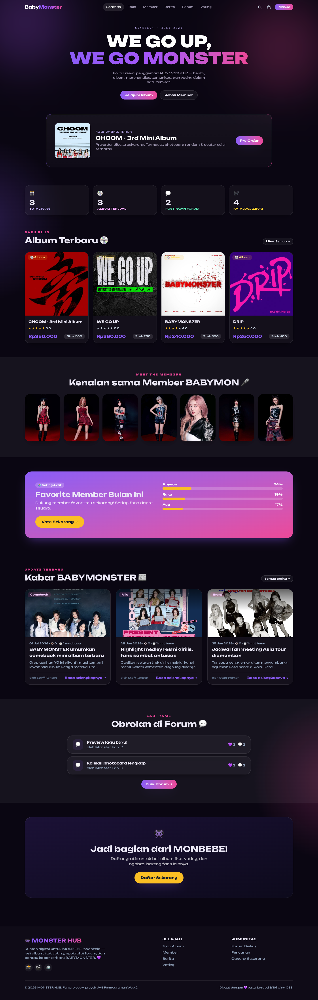
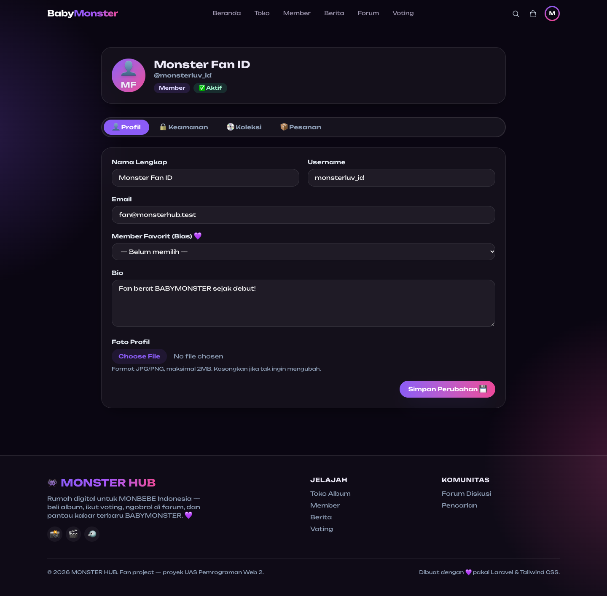
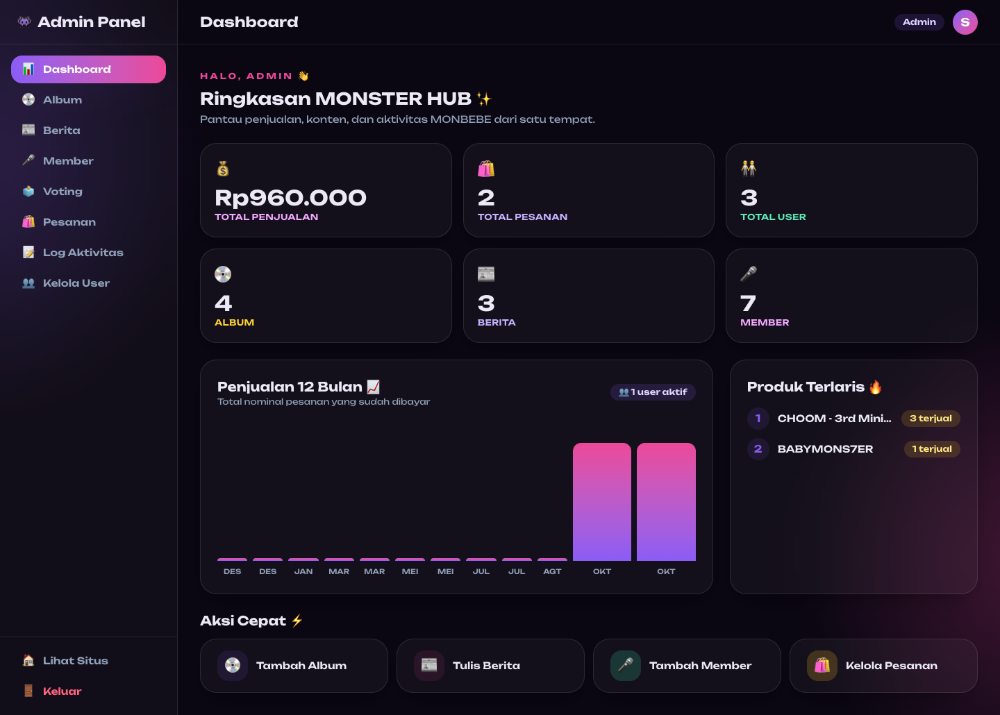
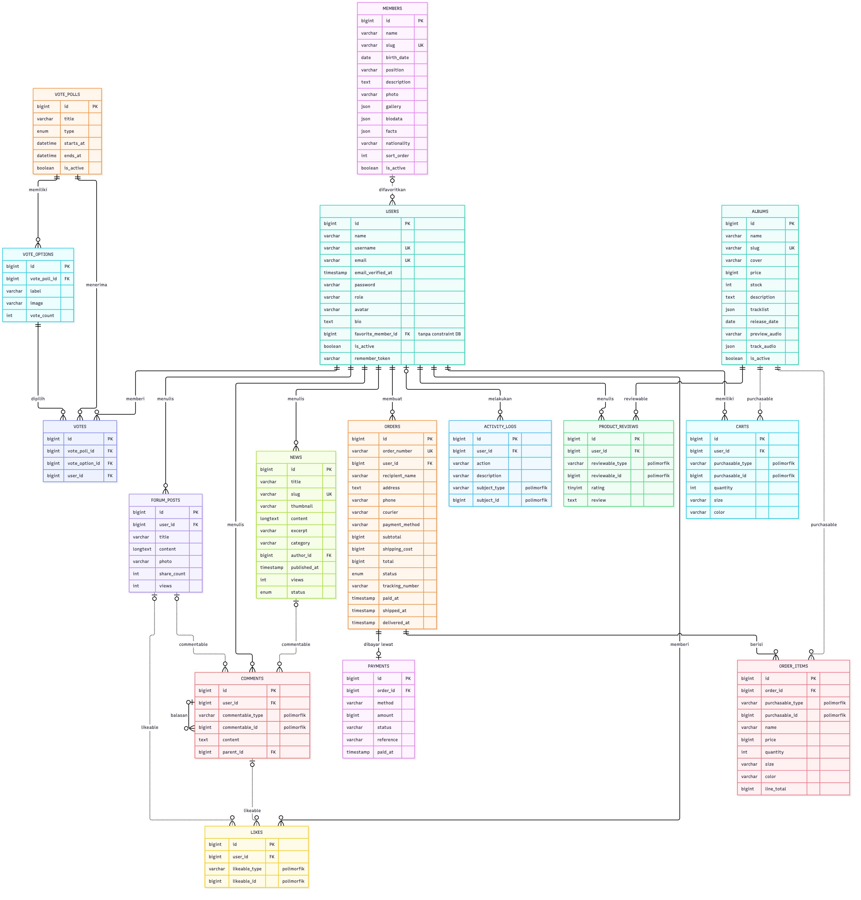

<p align="center">
  <b>👾 MONSTER HUB</b><br>
  <i>Rumahnya MONBEBE Indonesia — Platform Komunitas & Toko Album BABYMONSTER</i>
</p>

<p align="center">
  Laravel 12 · Blade · Tailwind CSS v4 · Alpine.js · SQLite
</p>

---

## 📖 Tentang Proyek

**MONSTER HUB** adalah aplikasi web untuk penggemar grup K-pop **BABYMONSTER**. Dalam satu tempat, fans dapat:

- 💿 **Beli album** (simulasi) — katalog, keranjang, checkout, invoice
- 🎵 **Putar preview album** lewat pemutar interaktif
- 🗳️ **Voting** member favorit (1 akun = 1 suara)
- 💬 **Forum komunitas** — buat post, komentar berjenjang, like
- 📰 **Berita & update** terbaru BABYMONSTER
- ⚙️ **Dashboard Admin** — CRUD konten, kelola pesanan & pengguna

Dibuat sebagai proyek **UAS Pemrograman Web 2**. Dokumen perencanaan lengkap ada di [`PRD.md`](PRD.md).

---

## Tampilan

| Beranda | Profil Member | Dashboard Admin |
|---|---|---|
|  |  |  |

Semua data pada tangkapan layar adalah data demo dari seeder.

---

## 🛠️ Teknologi

| Kategori | Teknologi |
|---|---|
| Backend | Laravel 12 (PHP 8.2+) |
| Frontend | Blade Components + Tailwind CSS v4 + Alpine.js |
| Build | Vite 7 |
| Database | SQLite |
| Auth | Session-based (Laravel Breeze style) |

---

## 🚀 Cara Menjalankan (Lokal)

### Prasyarat
- PHP **8.2+** dengan ekstensi `pdo_sqlite`
- Composer
- Node.js 18+ & npm

### Langkah
```bash
# 1. Install dependency PHP
composer install

# 2. Install dependency JS
npm install

# 3. Siapkan environment
cp .env.example .env
php artisan key:generate

# 4. Siapkan database (SQLite) + data demo
#    (file database/database.sqlite dibuat otomatis)
php artisan migrate:fresh --seed

# 5. Buat symlink storage (agar upload gambar tampil)
php artisan storage:link

# 6. Build aset frontend
npm run build

# 7. Jalankan server
php artisan serve
```

Buka **http://127.0.0.1:8000** 🎉

> **Mode pengembangan:** jalankan `npm run dev` (Vite hot-reload) di terminal terpisah dari `php artisan serve`.

---

## 👤 Akun Demo

| Peran | Email | Password |
|---|---|---|
| **Admin** | `admin@monsterhub.test` | `password` |
| **Staff** | `staff@monsterhub.test` | `password` |
| **Member** | `fan@monsterhub.test` | `password` |

Dashboard admin: **/admin/dashboard** (khusus admin & staff).

---

## 🔐 Catatan Keamanan

- Password di-hash dengan **bcrypt**.
- Kolom `role` & `is_active` **tidak** mass-assignable (anti privilege-escalation).
- Otorisasi berbasis peran via middleware `role:*`.
- Akses keranjang/pesanan diverifikasi kepemilikannya (anti-IDOR).
- Ongkos kirim & subtotal dihitung **di server**, bukan dari input klien.
- Proteksi CSRF & escaping XSS otomatis dari Laravel/Blade.

---

## 💳 Catatan Pembayaran

Pembayaran bersifat **SIMULASI** (sesuai lingkup UAS). Tidak ada integrasi payment gateway nyata — setelah pengguna memilih metode dan mengonfirmasi, pesanan langsung ditandai **lunas**.

---

## 📂 Struktur Fitur

```
Publik      : Beranda, Toko Album, Member, Berita, Forum, Voting, Pencarian
Member      : Keranjang, Checkout, Pesanan, Invoice, Ulasan, Profil
Admin/Staff : Dashboard, CRUD Album/Berita/Member, Voting, Pesanan, Log Aktivitas
Admin       : Manajemen Pengguna (peran & status akun)
```

---

## Relasi Database (ERD)



Garis tegas menunjukkan foreign key di database. Garis putus-putus menunjukkan relasi di level aplikasi tanpa foreign key, yaitu relasi polimorfik dan `users.favorite_member_id`.

---

<p align="center"><i>Dibuat dengan 💜 memakai Laravel & Tailwind CSS.</i></p>
